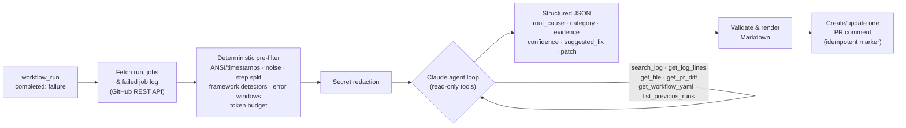

# Rootline

**Root-cause analysis for failed GitHub Actions runs, powered by Claude.**
When CI fails on a pull request, Rootline reads the failed job's log, works out *why* it failed, and
posts one short PR comment with the root cause, the evidence, a suggested fix and (when it is
confident) a patch you can review.

> **Status: early prototype (v0.1.0).** The pipeline described below is implemented and covered by
> tests, but it has not yet been run against real repositories at scale, and no accuracy numbers
> exist yet. Expect rough edges. Feedback and failing logs are very welcome.

## The problem

A red build usually means opening the job, scrolling through thousands of lines of install output,
warnings and retries, finding the one decisive line, and then connecting it to the diff, the workflow
config or a dependency change. It is the same detective work every time, and the failing step is often
not where the cause is.

## How it works



1. **Trigger.** A `workflow_run` event fires when your CI workflow completes with `failure`. Rootline
   picks the first failed job and the failed step (from the Jobs API).
2. **Fetch.** It downloads that job's log, and lazily (only if the agent asks) the PR diff, files at the
   tested commit, the workflow YAML and recent runs of the same workflow.
3. **Pre-filter (no model involved).** Strips ANSI codes and timestamps, resolves `\r` progress bars,
   splits the log into steps and scopes to the failing one, drops known noise (package downloads,
   docker layer progress, `env:` blocks…), collapses repeated lines and long stack traces, and runs
   detectors for **pytest, jest/vitest, go test/build, Maven, Gradle/Kotlin, npm, tsc, docker build,
   Python tracebacks** and infra signals (disk full, OOM, network). Error windows are ranked and packed
   into a token budget (default ~12k tokens), keeping line numbers.
4. **Redact.** Known token formats, private keys, credentials in URLs, `Authorization` headers,
   secret-looking `key=value` pairs and the values of secret-named environment variables are replaced
   with `[REDACTED:<kind>]`, on the log *and* on every tool result.
5. **Investigate with Claude.** Claude gets the excerpt plus structured failures and can call six
   read-only tools to confirm hypotheses (e.g. read the failing test, look at what the PR changed,
   check whether `main` is green). The loop is bounded (`max_turns`, default 8).
6. **Structured result.** The final answer is constrained by a JSON schema (structured outputs):
   `summary`, `root_cause`, `category` (`regression | flaky | config_env | dependency | infra | unknown`),
   `confidence` (`high | medium | low`), `evidence[]` (source, reference, quoted excerpt),
   `suggested_fix`, and `patch` (unified diff or empty). Patches that are not well-formed unified diffs
   are dropped.
7. **Comment.** The result is rendered to Markdown and posted as a single comment per PR and workflow;
   later failures update the same comment instead of adding new ones. `--dry-run` prints it instead.
   The comment is also written to the job summary.

Without an API key (or with `--no-llm`) Rootline still posts the deterministic findings: failing
step, detected failures and their messages.

See [docs/architecture.md](docs/architecture.md) for design details and the cost-control approach.

## Quickstart

### GitHub Action

Add `ANTHROPIC_API_KEY` as a repository secret, then create `.github/workflows/rootline.yml`:

```yaml
name: Rootline

on:
  workflow_run:
    workflows: ["CI"]          # name(s) of the workflow(s) to watch
    types: [completed]

permissions:
  actions: read                # read runs, jobs and logs
  contents: read               # read files and the workflow YAML at the tested commit
  pull-requests: write         # create/update the single Rootline comment

jobs:
  analyse:
    if: github.event.workflow_run.conclusion == 'failure'
    runs-on: ubuntu-latest
    steps:
      - uses: rootline-dev-ops/rootline@v0   # placeholder: pin to a release tag or commit SHA
        with:
          anthropic-api-key: ${{ secrets.ANTHROPIC_API_KEY }}
          # anthropic-workspace-id: ${{ secrets.ANTHROPIC_WORKSPACE_ID }}  # only for multi-workspace keys
          # model: claude-sonnet-5-5
          # escalation-model: claude-opus-5-5
```

`workflow_run` workflows run from the default branch, so this file must be merged there first.

### CLI

```bash
pip install git+https://github.com/rootline-dev-ops/rootline   # placeholder URL

# See exactly what would be sent to the model (no API key needed)
rootline prefilter --log-file ci.log

# Deterministic findings only, as a Markdown comment
rootline analyze --log-file ci.log --no-llm

# Full analysis of a local log, with a checkout for get_file / git diff
export ANTHROPIC_API_KEY=...
rootline analyze --log-file ci.log --repo-dir . --base origin/main --workflow-file .github/workflows/ci.yml

# Analyse a real run and print the comment instead of posting it
export GITHUB_TOKEN=...   # needs actions:read, contents:read (and pull-requests:write to post)
rootline analyze --repo owner/name --run-id 1234567890 --dry-run --json-out report.json

# Re-render a saved report
rootline render --report report.json
```

## Configuration

| Action input | Env var / CLI flag | Default | Meaning |
|---|---|---|---|
| `anthropic-api-key` | `ANTHROPIC_API_KEY` | – | Without it, deterministic findings only |
| `anthropic-workspace-id` | `ANTHROPIC_WORKSPACE_ID` | – | `wrkspc_…` ID; only needed for keys not scoped to one workspace |
| `github-token` | `GITHUB_TOKEN` | `${{ github.token }}` | Read run/logs/code, write the comment |
| `run-id` | `ROOTLINE_RUN_ID` / `--run-id` | triggering run | Run to analyse |
| `model` | `ROOTLINE_MODEL` / `--model` | `claude-sonnet-5-5` | Claude model id |
| `escalation-model` | `ROOTLINE_ESCALATION_MODEL` | – | Re-run once on this model if confidence is `low` |
| `max-turns` | `ROOTLINE_MAX_TURNS` / `--max-turns` | `8` | Agent turn limit |
| `log-budget-tokens` | `ROOTLINE_LOG_BUDGET_TOKENS` / `--budget-tokens` | `12000` | Approx. size of the log excerpt |
| `effort` | `ROOTLINE_EFFORT` | model default | `low`…`max`, passed as `output_config.effort` |
| `dry-run` | `--dry-run` | `false` | Print instead of commenting |
| – | `ROOTLINE_MAX_OUTPUT_TOKENS` | `16000` | `max_tokens` per request |
| – | `ROOTLINE_CACHE_TTL` | `5m` | Prompt-cache TTL (`5m` or `1h`) |
| – | `ROOTLINE_REDACT_PATTERNS` | – | Extra redaction regexes, one per line |
| – | `--job-id`, `--pr`, `--comment-key`, `--force`, `--json-out` | | See `rootline analyze --help` |

Action outputs: `category`, `confidence`, `comment-url`.

## Security & privacy

**What is sent to Anthropic** (only when an API key is configured): run metadata (repository, workflow
and job names, branch, commit SHA and first line of the commit message, PR number), the pre-filtered
log excerpt (by default ~12k tokens, not the full log), and the results of tools the model calls during
the investigation: log searches, file contents at the tested commit, the PR diff, the workflow YAML and
summaries of recent runs. Everything passes through the redaction step first. Use
`rootline prefilter` to inspect the excerpt locally.

**Safeguards implemented in this repository:**

- **Secret redaction** (`src/rootline/redact.py`) on the log, every tool result and the model's output
  before it is posted. Covers GitHub/Anthropic/OpenAI/AWS/Slack/Google/Stripe/npm tokens, JWTs, PEM
  private keys, `Authorization`/bearer headers, `user:pass@` URLs, secret-named `key=value` pairs, the
  literal values of secret-named environment variables, and custom regexes. This is best-effort and
  regex-based; it cannot catch every secret.
- **Read-only tools.** The agent cannot write, push, run code or call arbitrary URLs. The only side
  effect of a run is the PR comment, posted by deterministic code after the agent finishes.
- **Sensitive-file denylist** for `get_file` (`.env*`, keys/certificates, `.npmrc`, `.pypirc`,
  `.netrc`, paths containing `secret`/`credential`, `.git/`) and path-traversal checks.
- **No code execution.** Rootline never checks out or runs the PR's code, which matters because
  `workflow_run` jobs have access to secrets even for PRs from forks.
- **Prompt-injection hygiene.** Logs, diffs and files are treated as untrusted data in the system prompt,
  output is schema-constrained, `@mentions` in model text are neutralised, and only comments that *start*
  with Rootline's marker are updated (a comment that merely quotes the marker is ignored).
- **Least-privilege token:** `actions: read`, `contents: read`, `pull-requests: write`.

Anthropic's API terms state that API inputs and outputs are not used for model training by default;
check the current terms and your organisation's policy before enabling Rootline on private code.

## Development

```bash
python -m venv .venv && . .venv/bin/activate
pip install -e ".[dev]"
ruff check . && ruff format --check . && pytest
```

Tests use realistic sample logs in `tests/fixtures/` (written for this project) and never call the
Anthropic API: the agent loop is tested with a scripted fake client, and `tests/test_sdk_wire.py`
drives the real `anthropic` SDK against a local stub server to check request serialisation (tools,
cache breakpoints, structured output config, thinking/tool-result round-trips).

## Roadmap

Honest list of what is *not* done yet:

- [ ] Live evaluation on a corpus of real failed runs (root-cause accuracy, fix acceptance) with an eval
      harness, before claiming any accuracy numbers
- [ ] Multi-job analysis (today: the first failed job; other failed jobs are listed in the metadata)
- [ ] Two-stage model tiering by default (cheap triage model, stronger model for investigation); today
      only confidence-based escalation is implemented
- [ ] Flaky-test detection from historical runs and re-run outcomes (beyond the `list_previous_runs` tool)
- [ ] Validate proposed patches with `git apply --check` against the tested commit
- [ ] GitHub App (no workflow file needed), per-repo config file and custom context/rules
- [ ] Other CI systems (GitLab CI, CircleCI, Buildkite, Jenkins)
- [ ] Opt-in fix commits / suggested-change blocks, always behind human approval

## License

[MIT](LICENSE) © 2026 Hasan Çelik
