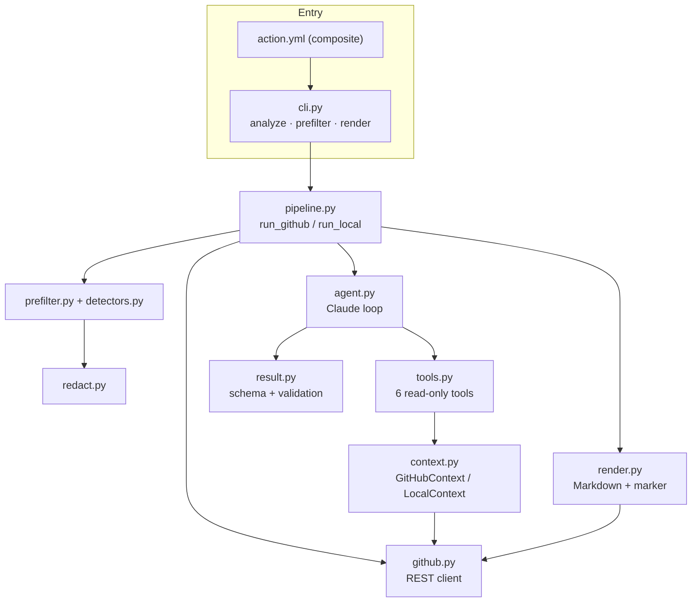

# Rootline architecture

This document describes how the v0.1.0 prototype works and why it is built this way. Everything here
reflects code in `src/rootline/`; planned work is marked as such.

## Components

| Module | Responsibility |
|---|---|
| `cli.py` | Argument parsing; writes `$GITHUB_STEP_SUMMARY` and `$GITHUB_OUTPUT`; dry-run handling |
| `pipeline.py` | Orchestration; picks the failed job/step; degrades to deterministic output on any model error |
| `github.py` | Runs, jobs, job logs, contents, PR diff, PR lookup (incl. fork PRs), comment upsert |
| `prefilter.py` | Normalisation, step segmentation, noise filtering, windowing, budgeting |
| `detectors.py` | Framework-specific regex detectors producing `Failure` records and anchor lines |
| `redact.py` | Secret redaction applied to all model-bound text and to the model's output |
| `context.py` | Data providers behind the tools; path denylist; no code execution |
| `tools.py` | Tool schemas and handlers; per-result redaction and size caps; call log |
| `agent.py` | Messages API loop with tool use, prompt caching, structured output, turn limit, escalation |
| `result.py` | JSON schema for the analysis; normalisation; patch well-formedness check |
| `render.py` | PR comment Markdown; idempotency marker; mention/fence safety; size cap |

## Data flow in GitHub mode

1. `GET /repos/{repo}/actions/runs/{id}`: skip unless the conclusion is `failure`, `timed_out` or
   `startup_failure` (override with `--force`).
2. `GET .../runs/{id}/jobs?filter=latest`: first failed job by completion time; failed step name from
   `steps[].conclusion`. Other failed jobs are listed in the metadata sent to the model.
3. `GET .../jobs/{job_id}/logs`: plain-text log (via a signed redirect; `requests` drops the
   `Authorization` header on the cross-host redirect).
4. PR lookup: `run.pull_requests[0]`, else `GET /commits/{sha}/pulls` (open PRs), else
   `GET /pulls?head=<fork-owner>:<branch>` matched on head SHA (fork PRs, where `pull_requests` is empty).
5. Pre-filter + redaction (below), then the agent loop. Tools fetch more context lazily.
6. Comment upsert: list issue comments, update the first one whose body *starts with*
   `<!-- rootline:report key=<workflow path> -->`, otherwise create one. The key is per workflow, so
   two different failing workflows on one PR get two comments, and re-runs update in place.

## Pre-filter

The goal is to send the model the smallest excerpt that still contains the decisive evidence, in a
form that is deterministic, testable and cheap.

1. **Normalise.** Redact first (so multi-line PEM blocks are caught), then per line: keep the final
   segment of `\r`-separated progress output, strip ANSI CSI/OSC sequences and GitHub's
   `2026-10-09T13:42:07.1234567Z` prefixes and the BOM.
2. **Steps.** `##[group]Run …` headers delimit steps. The failing step is matched from the API hint or,
   failing that, the step containing the first `##[error]`. Post-job steps are excluded. The `shell:` /
   `env:` block GitHub prints at the start of each step is dropped (it often contains configuration
   values and is rarely useful).
3. **Noise.** Regexes for pip/apt/npm/maven/go module download output, git fetch progress, docker
   layer progress and `CACHED`/`DONE` lines, tqdm-style bars and blank lines.
4. **Detectors.** Each detector returns structured `Failure(framework, name, message, line)` records
   and *anchors* (line index → priority 1–3, plus an optional span to keep after it, e.g. a traceback
   or Gradle's "What went wrong" block). Supported: pytest, jest/vitest, go test/build, Maven
   (surefire summaries, compiler errors, failed goals), Gradle/Kotlin, npm (`ERR!`/`error` codes),
   tsc, docker/buildkit, Python tracebacks, GitHub `##[error]` annotations, and generic error/infra
   patterns (disk full, OOM, DNS/connection resets, rate limits).
5. **Windows.** Each anchor gets a context window (wider for high-priority anchors), overlapping
   windows are merged and scored by (max priority, total anchor weight, recency).
6. **Compression.** Runs of stack frames keep the first six non-framework frames
   (`node_modules`, `node:internal`, `java.base`, JUnit/surefire/Gradle internals are hidden first).
   Identical consecutive lines collapse; digit-only variations collapse too unless the line is a
   priority ≥2 anchor (so 400 distinct compiler errors are not merged into one).
7. **Budget.** A header (failing step, detected tooling, up to 25 structured failures, `##[error]`
   annotations) is always included. Windows are then added best-first until the character budget
   (`budget_tokens × 4`) is used, and emitted in log order with `… [N lines omitted]` separators,
   followed by the tail of the failing step if it fits. Every kept line carries its line number in
   the normalised log; the `search_log` / `get_log_lines` tools use the same numbering, so the model
   can ask for exactly what was cut.

Token counts here are a deliberate ~4 chars/token estimate: budgeting only needs to be approximately
right and must be deterministic for tests. Real usage is taken from the API response and reported.

## Agent loop

- **Request shape.** `system` (one text block), `tools` (six JSON-schema tools),
  `messages` (run metadata + excerpt, then instructions), and
  `output_config.format = {type: json_schema, schema: ANALYSIS_SCHEMA}`. `output_config.effort` is set
  only when configured. No `temperature` or forced `tool_choice` is sent (Claude Sonnet 5.5, the default model, rejects
  non-default sampling parameters and forced tool use).
- **Loop.** While `stop_reason == "tool_use"`: execute every `tool_use` block, return all
  `tool_result`s in one user message (errors flagged with `is_error`), and continue. The full assistant
  content is replayed verbatim, so thinking blocks and signatures are preserved. On the last allowed
  turn the model is told the tool budget is exhausted and must answer.
- **Termination.** `end_turn` → parse JSON (schema-constrained, with a defensive `{…}` extraction
  fallback); `refusal` / `max_tokens` / empty output raise `AgentError`, and the pipeline falls back to a
  deterministic comment that states why AI analysis is unavailable.
- **Validation.** Category/confidence are normalised case-insensitively (structured outputs do not
  guarantee enum casing). Patches are kept only if they contain `---`/`+++` headers and a valid `@@`
  hunk header. Model text is redacted again before rendering.
- **Tools.** `search_log`, `get_log_lines`, `get_file` (numbered lines, 400-line default window),
  `get_pr_diff` (optional path filter, with a changed-files index), `get_workflow_yaml`,
  `list_previous_runs` (same workflow on the PR branch and the default branch). All results are
  redacted and capped at 20,000 characters.

## Cost control

Rootline's cost per analysis is dominated by input tokens: the excerpt, plus whatever the tools
return, re-sent on every turn of the loop. The prototype controls this in four ways:

1. **Deterministic pre-filter.** Most of a CI log is setup noise. The excerpt is bounded by
   `log-budget-tokens` (default 12k) regardless of log size; the model pulls more only when it needs
   it, through targeted `search_log` / `get_log_lines` calls instead of receiving the whole log.
2. **Prompt caching.** Up to four `cache_control` breakpoints per request:
   (a) the last tool definition, caching the tools array; (b) the system prompt;
   (c) the run-metadata + excerpt block; (d) a *moving* breakpoint on the newest `tool_result`, removed
   from older turns, so each turn reads the growing conversation prefix from cache. In an N-turn loop,
   the excerpt is written to the cache once and read N-1 times. Cache reads are billed at a fraction
   of the base input price (see Anthropic's pricing page for current rates), and the TTL is
   configurable (`5m` default, `1h` for bursts of failures).
3. **Bounded investigation.** `max_turns` (default 8), per-tool result caps, and a system prompt that
   asks for 2–6 tool calls and forbids re-requesting content already present.
4. **Model tiering.** Default model `claude-sonnet-5-5`. An optional `escalation-model` (e.g.
   `claude-opus-5-5`) is used only when the first answer comes back with `confidence: low`. `effort` can
   be lowered for cheaper, faster runs.

Usage (`input_tokens`, `output_tokens`, `cache_creation_input_tokens`, `cache_read_input_tokens`) is
summed across turns and models and stored in the JSON report (`--json-out`), so real per-analysis cost
can be measured once Rootline runs on real repositories. **No cost measurements exist yet.**

Planned: a cheap triage pass (e.g. a Haiku-class model) that classifies obvious infra/dependency
failures from the excerpt alone and skips the agent loop; batch processing for non-urgent re-analysis;
and an eval harness to tune the budget and turn limits against accuracy.

## Security model

- Trust boundary: everything from the repository (logs, diff, files) is untrusted input to the model.
  The model has no write tools; the comment is the only output and is rendered by deterministic code.
- `workflow_run` executes in the base repository with access to secrets even for fork PRs. Rootline
  never checks out or executes PR code; it only reads through the API.
- `get_file` refuses denylisted paths (`.env*`, key/cert files, `.npmrc`, `.pypirc`, `.netrc`,
  `*secret*`, `*credential*`, `.git/`), absolute/parent-traversal paths, and (local mode) symlink
  escapes from the repository root.
- Redaction is applied three times: to the log before pre-filtering, to every tool result, and to the
  model's output. It is regex-based and best-effort.
- Comment safety: `@mentions` are broken with a zero-width space, `-->` cannot close the marker,
  code fences are sized to their content, and comments are capped below GitHub's 65,536-character limit.

## Known limitations

- Only the first failed job is analysed.
- Step detection relies on `##[group]Run …` headers; logs without them are treated as a single step.
- Detectors are regex-based and cover common output formats; unusual reporters fall back to generic
  error windows.
- The ~4 chars/token estimate can be off for non-Latin text; the budget is approximate.
- No accuracy evaluation has been done yet.
